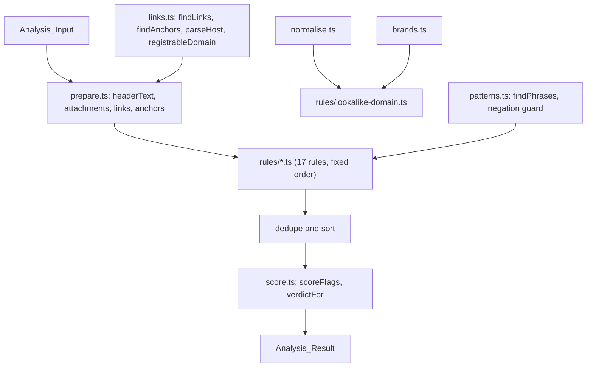

# Design Document: Detection Engine

## Overview

`analyse(input)` is a pure, synchronous function. It prepares the input once (header text, attachment list, links and HTML or Markdown anchors), runs every rule in a fixed order, removes exact duplicates, sorts the flags, scores them and picks a verdict. All matching runs on the original text, so spans are exact. Look-alike comparison runs on a normalised copy of short strings such as domain labels.

### Key decisions

| Decision | Choice | Reason |
| --- | --- | --- |
| Span convention | `source` plus `[start, end)` offsets into that source | The UI highlights the exact words. Body spans index `input.text`, header spans index `result.headerText`, attachment spans index the attachment name. |
| Score formula | `100 * (1 - product over types of (1 - w))`, where `w` is the strongest weight of that type | Each factor is at most 1, so adding a flag can only lower the product and raise the score. Counting one flag per type stops a repeated phrase from inflating the score. |
| Weights | high 0.5, medium 0.25, low 0.1 | One high flag gives 50 (suspicious). A high and a medium together give 63 (likely scam). One medium gives 25 (suspicious). |
| Score cap | 99 | A score of 100 reads as certainty, which the product rules forbid. |
| Verdict | 60 or more likely scam, 25 to 59 suspicious, below 25 looks safe | Matches the weights above. |
| Negation guard | Skip a request match when the same sentence has "never", "not", "do not" or similar before it | Genuine bank messages say "Never share your OTP". |
| Overlaps | Within one rule keep the higher severity, then the earlier, then the longer match | One clear highlight per phrase. |
| Brand list | Built-in list of brand keys and official registrable domains | No network lookups. Real brand names are needed for detection. Samples and tests use made-up domains. |
| Normaliser | NFKC, lower-case, confusable map, `rn` to `m`, `vv` to `w`, repeated to a fixed point | The fixed point makes the function idempotent by construction. |

## Architecture



## Components and Interfaces

- `src/detection/types.ts`: `Severity`, `Verdict`, `FlagSource`, `FLAG_TYPES`, `FlagType`, `RedFlag`, `AnalysisInput`, `AnalysisResult`, `Link`, `AnchorLink`, `PreparedInput`, `Rule`.
- `src/detection/flag.ts`: `makeFlag`, which builds the `id` and fills `text` from the source string.
- `src/detection/normalise.ts`: `normaliseConfusables(value: string): string`.
- `src/detection/links.ts`: `findLinks(text)`, `findAnchors(text)`, `parseHost(url)`, `registrableDomain(host)`, `isIpHost(host)`.
- `src/detection/brands.ts`: `BRANDS`, `levenshtein`, `findBrandLookalike(host)`.
- `src/detection/patterns.ts`: `findPhrases(text, patterns, options)` and `isNegated(text, start)`.
- `src/detection/score.ts`: `SEVERITY_WEIGHT`, `scoreFlags(flags)`, `verdictFor(score)`.
- `src/detection/prepare.ts`: `prepare(input): PreparedInput`.
- `src/detection/rules/index.ts`: `RULES`, the ordered list of all rules.
- `src/detection/analyse.ts` and `src/detection/index.ts`: `analyse` and the public exports.

Rules, one file each in `src/detection/rules/`:

| File | Flag type | Source |
| --- | --- | --- |
| `lookalike-domain.ts` | `lookalike-domain` | body links, header From, Reply-To and Return-Path |
| `link-text-mismatch.ts` | `link-text-mismatch` | body anchors |
| `url-shortener.ts` | `url-shortener` | body links |
| `ip-link.ts` | `ip-link` | body links |
| `risky-tld.ts` | `risky-tld` | body links |
| `email-auth-fail.ts` | `email-auth-fail` | header text |
| `urgency-threats.ts` | `urgency`, `threat` | body |
| `sensitive-info-request.ts` | `sensitive-info-request` | body |
| `remote-access-app.ts` | `remote-access-app` | body |
| `payment-request.ts` | `payment-request` | body |
| `kyc-expiry.ts` | `kyc-expiry` | body |
| `courier-fee.ts` | `courier-fee` | body |
| `electricity-disconnection.ts` | `electricity-disconnection` | body |
| `upi-refund.ts` | `upi-refund` | body |
| `job-task-scam.ts` | `job-task-scam` | body |
| `digital-arrest.ts` | `digital-arrest` | body |
| `risky-attachment.ts` | `risky-attachment` | attachments and file names in the body |

`src/data/samples.ts` exports `SAMPLES: SampleMessage[]` with `id`, `channel`, `title`, `text`, optional `headers` and `attachments`, `expectedVerdict` and `expectedFlags`.

## Data Models

```ts
type Severity = 'low' | 'medium' | 'high';
type Verdict = 'likely scam' | 'suspicious' | 'looks safe';
type FlagSource = 'body' | 'header' | 'attachment';

interface RedFlag {
  id: string;            // type:source:attachmentIndex:start:end
  type: FlagType;
  label: string;         // 1 to 40 characters
  severity: Severity;
  reason: string;        // one line, no certainty claims
  source: FlagSource;
  start: number;         // inclusive UTF-16 offset
  end: number;           // exclusive UTF-16 offset
  text: string;          // source.slice(start, end)
  attachmentIndex?: number;
}

interface AnalysisResult { score: number; verdict: Verdict; flags: RedFlag[]; headerText: string; }
```

## Correctness Properties

*A property is a characteristic or behavior that should hold true across all valid executions of a system-essentially, a formal statement about what the system should do. Properties serve as the bridge between human-readable specifications and machine-verifiable correctness guarantees.*

### Property 1: Score stays within 0 to 100

*For any* Analysis_Input, including arbitrary Unicode text, headers and attachment names, `analyse(input).score` is an integer between 0 and 100.

**Validates: Requirements 3.1, 3.6**

### Property 2: Adding a red flag never lowers the score

*For any* list of flags `fs` and any flag `f`, `scoreFlags([...fs, f]) >= scoreFlags(fs)`.

**Validates: Requirements 3.2, 3.5**

### Property 3: Homoglyph normalisation is idempotent

*For any* string `s`, `normaliseConfusables(normaliseConfusables(s))` equals `normaliseConfusables(s)`.

**Validates: Requirements 8.2**

### Property 4: Empty input looks safe

*For any* string made only of whitespace, `analyse({ text })` returns score 0, verdict `looks safe` and no flags.

**Validates: Requirements 3.4**

### Property 5: Spans are exact

*For any* input, every flag has `0 <= start < end <= length of its source`, and `text` equals the source sliced from `start` to `end`.

**Validates: Requirements 2.2, 2.3**

### Property 6: Analysis is deterministic and the verdict follows the score

*For any* input, two calls to `analyse` return deeply equal results, and the verdict equals `verdictFor(score)`.

**Validates: Requirements 1.3, 3.3**

## Error Handling

- Missing `headers` or `attachments` are treated as empty.
- Malformed URLs never throw. Hosts are parsed with string operations only, never `new URL`.
- Zero-length regex matches are skipped, so no rule can loop or return an empty span.

## Testing Strategy

- One co-located test file per rule with examples of what it flags, what it must not flag, and exact span text.
- `src/detection/score.test.ts`: Property 2 and examples for each verdict boundary.
- `src/detection/normalise.test.ts`: Property 3 and examples (paypa1, arnazon, Cyrillic letters).
- `src/detection/analyse.test.ts`: Properties 1, 4, 5 and 6 and the no-certainty check on every reason.
- `src/data/samples.test.ts`: every sample gets its expected verdict, the scams cover every flag type, and genuine samples have no medium or high flags.
- Every property test uses fast-check with at least 100 runs and a comment naming the property.