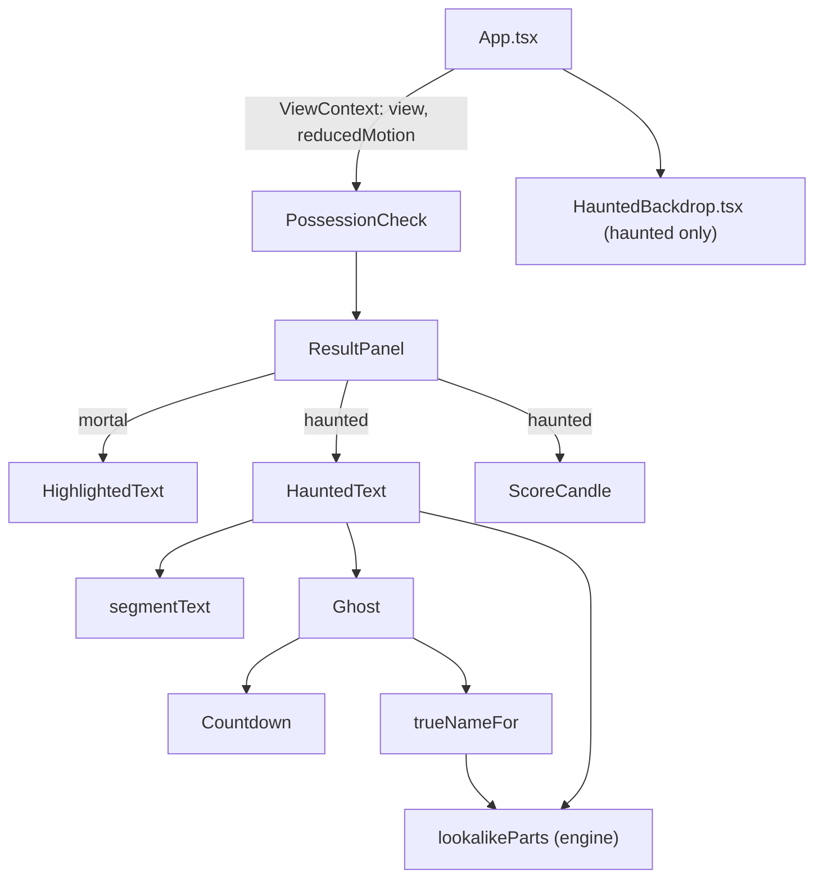
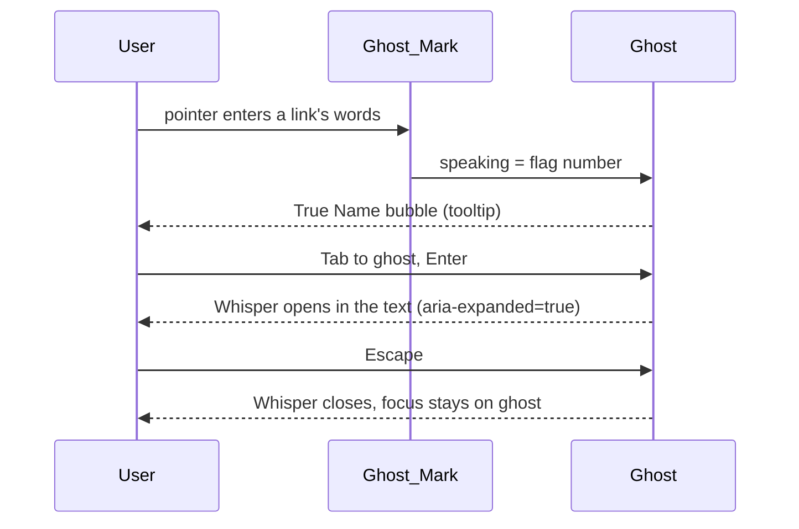

# Design Document: Haunted View

## Overview

Haunted view is a second skin over the same screen. The shell already switches `data-view` on the root and remembers it. This feature adds:

- a decorative Backdrop (sky, moon, mansion, bats, fog);
- haunted Panel styling with candle glow;
- a heading font;
- a ghost layer for results: ghost marks, ghost buttons, whispers, True Name bubbles and countdowns;
- a Score_Candle.

Mortal view keeps its current components. The result panel picks the haunted or the mortal renderer from a small view context.

### Key decisions

| Decision | Choice | Reason |
| --- | --- | --- |
| How features learn the view | `ViewContext` in `src/view-context.ts`, provided by `App` | The feature needs the view and reduced-motion state. Prop drilling through `PossessionCheck` would couple it to the shell. |
| Text never on fog | Every text block sits on an opaque Panel in Haunted view, and the Backdrop sits behind at `z-index: 0` | Contrast then depends only on token pairs, which the token test checks. Fog can never lower it. |
| Candle glow contrast | Glow is a `::before` layer inside each Panel with at most `--candle-glow-strength` of `--color-candle` | The token test blends that colour into the surface at full strength and checks every text pair on the result. |
| Motion budget | Continuous animations use only `transform` and `opacity` | These run on the compositor, which keeps phones smooth. No animated `filter`, `box-shadow` or layout. |
| Flash safety | Flicker changes the opacity of a 14% glow between 0.65 and 1, with irregular steps of 120 ms or more | This is far below WCAG 2.3.1 flash thresholds. |
| Ghost placement | A ghost button after the end of each flag span, inside the text | It sits on the exact words, works with keyboard and screen readers, and needs no measuring. |
| Ghost size | 44px minimum target with line-height 2.4 in haunted message text | This meets the design-system target rule without overlapping lines. |
| True Name bubble | `role="tooltip"` element under the ghost, linked by `aria-describedby`, shown on hover and focus, hidden on Escape | This follows WCAG 1.4.13: the bubble is dismissible, hoverable and persistent. The same text is also in the Whisper for touch users. |
| Bubble width | `max-width: min(20rem, 100%)` of the message container, anchored to the paragraph, not the ghost | It cannot overflow a phone screen and needs no inline styles, which the CSP blocks. |
| Whisper | `hidden` span in the text flow, opened by `aria-expanded` disclosure | It never covers text and works on phones. |
| Real destination | New `destination` field on link flags in the engine | The UI needs the real URL. The engine already knows it, and nothing is fetched. |
| Lookalike letters | `lookalikeParts(host)` in the engine maps folded brand matches back to source characters | The `1` in `paypa1` is found exactly, while plain brand-name abuse (`indiapost-...`) returns nothing and glows as a whole. |
| Countdown | Client-side `setInterval(1000)` only while shown and not in reduced motion | The engine stays pure. The ghost mocks the deadline rather than tracking anything real. |
| Candle melt | SVG geometry attributes plus SMIL `<animate>`, omitted in reduced motion | Per-score heights need no inline style. SMIL is not blocked by the CSP. |
| Heading font | `@fontsource/creepster` (SIL OFL 1.1), imported once, `font-display: swap` | Same-origin files pass `font-src 'self'`. Browsers fetch the file only when an element uses the family. |

## Architecture





## Components and Interfaces

- `src/view-context.ts`: `ViewContext`, `useViewSettings(): { view: View; reducedMotion: boolean }`.
- `src/components/HauntedBackdrop.tsx`: `aria-hidden` sky, stars, moon, mansion SVG, bats and fog layers.
- `src/styles/haunted.css`: haunted Panels, candle glow, heading font, backdrop and fog keyframes.
- `src/features/possession-check/ghosts/ghost-effects.ts`:
  - `ghostKind(flag): 'lookalike' | 'bleed' | 'link' | 'haunt'`
  - `isLinkFlag(flag)`
  - `deadlineOf(text): number | 'midnight' | undefined`
  - `secondsUntilMidnight(now: Date)`
  - `formatCountdown(seconds)`
  - `trueNameFor(flag): TrueName | undefined`
  - `candleWaxHeight(score, full, stub)`
- `ghosts/HauntedText.tsx`: renders marks, lookalike parts and ghosts for one text source. It holds `speaking` and `open` state.
- `ghosts/Ghost.tsx`: button, bubble and Whisper. `ghosts/GhostIcon.tsx`: SVG. `ghosts/Countdown.tsx`. `ghosts/TrueNameText.tsx`.
- `ScoreCandle.tsx`: `({ score, animate })`.
- Engine: `RedFlag.destination?: string`, `lookalikeParts(host): Range[]`, and exports of `parseHost` and `registrableDomain`.

## Data Models

```ts
type GhostKind = 'lookalike' | 'bleed' | 'link' | 'haunt';

interface Range { start: number; end: number }

interface TrueName {
  address: string;      // the real destination or sender domain
  parts: Range[];       // suspicious ranges inside address
  note: string;         // one plain-English line
}
```

New tokens, in both views: `--font-family-heading`, `--color-ghost`, `--color-ghost-ink`, `--color-ghost-warn`, `--color-candle`, `--candle-glow-strength`, `--color-wax`, `--color-sky-top`, `--color-sky-bottom`, `--color-mansion`, `--color-moon`, `--color-fog` and `--fog-strength`.

## Correctness Properties

*A property is a characteristic or behavior that should hold true across all valid executions of a system-essentially, a formal statement about what the system should do. Properties serve as the bridge between human-readable specifications and machine-verifiable correctness guarantees.*

### Property 1: Lookalike parts are exactly the substituted letters

*For any* brand key and any choice of letters in it replaced by a look-alike (digit, Cyrillic letter, or `rn` for `m`), placed in a host such as `<key>-secure.example`, `lookalikeParts` returns exactly the ranges of the replaced characters, sorted and non-overlapping.

**Validates: Requirements 4.1, 4.2**

### Property 2: Lookalike parts stay inside the host

*For any* string, `lookalikeParts` returns ranges with `0 <= start < end <= length`, sorted and non-overlapping.

**Validates: Requirements 4.2**

### Property 3: The candle never grows as the score rises

*For any* two scores `a <= b` from 0 to 100, `candleWaxHeight(b) <= candleWaxHeight(a)`. Every height lies between the stub and the full height, and score 0 gives the full height.

**Validates: Requirements 7.2**

### Property 4: Countdown text round-trips

*For any* whole number of seconds from 0 to 30 days, `formatCountdown` gives `H...H:MM:SS` text that parses back to the same number. For any `n` from 1 to 99 and any unit, `deadlineOf("within n <unit>")` equals `n` times the unit's seconds.

**Validates: Requirements 4.4**

### Property 5: True Name parts point inside the address

*For any* link flag produced by the engine for a generated message, `trueNameFor` returns an address equal to the flag's destination (or sender domain), with at least one non-empty part, and every part inside the address.

**Validates: Requirements 5.1, 5.3**

## Error Handling

- No `matchMedia`: the system reduced-motion setting is treated as off, as the foundation already does.
- A countdown for a deadline longer than 30 days is clamped to 30 days.
- `trueNameFor` returns `undefined` for non-link flags, and the ghost then shows no bubble.
- If the heading font fails to load, `font-display: swap` keeps the Georgia fallback.

## Testing Strategy

- `src/detection/brands.test.ts`: Properties 1 and 2, plus examples (`paypa1`, `arnazon`, Cyrillic, plain brand use).
- `ghosts/ghost-effects.test.ts`: Properties 3, 4 and 5, plus examples for each kind, deadline wording and True Name notes.
- `ghosts/HauntedText.test.tsx`:
  - Ghosts per flag with labels of 1 to 40 characters and 44px targets.
  - Lookalike letter elements, bleed marks and countdown ticks with fake timers.
  - A static countdown in reduced motion, the True Name bubble on hover and focus, Escape, and Whisper open and close with focus kept.
  - Plain-text rendering.
- `PossessionCheck.test.tsx` additions:
  - The candle shows in Haunted view and not in Mortal view, and is shorter for higher scores. There is no SMIL in reduced motion.
  - Results survive a view switch, the toggle is remembered, and axe passes in Haunted view with a Whisper open.
- `src/styles/tokens.test.ts` additions: new tokens, ghost text pairs, and the candle glow blended at full strength.
- `scripts/perf-mobile.mjs`: manual run, with results in `docs/perf-mobile.md`.