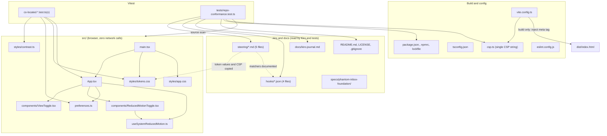
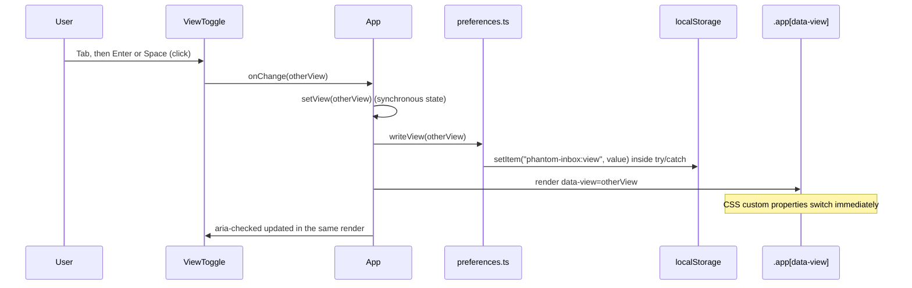
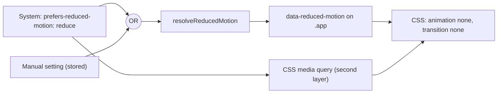
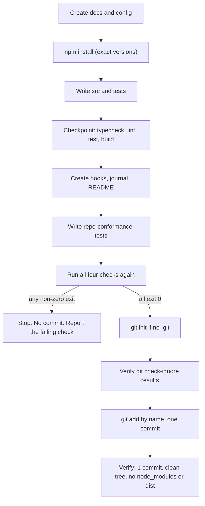

# Design Document: Phantom Inbox Foundation

## Overview

This design covers the foundation step of Phantom Inbox only: five steering documents, a runnable React + Vite + strict TypeScript scaffold with a placeholder app shell, four agent hooks, a journal, README, LICENSE, `.gitignore`, a conformance test file, and one initial git commit. No detection logic exists in this step.

The deliverable is mostly documents and configuration. Only a small amount of logic is real code, and that logic is kept in pure, separately testable modules:

| Module | Responsibility |
| --- | --- |
| `src/styles/contrast.ts` | WCAG 2.1 contrast ratio from hex colours |
| `src/preferences.ts` | Safe read/write of the two stored preferences, `parseView`, `resolveReducedMotion` |
| `src/useSystemReducedMotion.ts` | Subscribes to the `prefers-reduced-motion` media query |
| `src/components/*` and `src/App.tsx` | The placeholder shell and its two switches |
| `csp.ts` | The single Content-Security-Policy string |
| `vite.config.ts` | Build-only plugin that injects the CSP meta tag |
| `tests/repo-conformance.test.ts` | Checks the documents, hooks, journal, license and README |

### Design decisions and rationale

| Decision | Choice | Reason |
| --- | --- | --- |
| Stack | React + Vite + strict TypeScript | Fixed by the requirements. Vite builds to plain static files, which satisfies free static hosting and Requirement 16.2. |
| Test runner | Vitest with jsdom | Shares the Vite config, so there is one transform pipeline. `vitest --run` exits after one run (Requirement 7.6). |
| Property testing | fast-check | Required by Requirement 9.2. Integrates directly with Vitest, so no custom runner is written. |
| Contrast check | Pure function plus a token-pair test | jsdom cannot compute rendered colour. Testing declared token pairs is the reliable check (Requirement 9.8). axe-core's `color-contrast` rule is disabled in jsdom. |
| axe scope | Run axe with `runOnly` set to WCAG 2.0/2.1 A and AA tags | Page-level best-practice rules (for example `page-has-heading-one`) are noisy when axe runs on a rendered container instead of a full page. |
| CSP delivery | One string in `csp.ts`, injected as a `<meta http-equiv="Content-Security-Policy">` by a build-only Vite plugin | Static hosts differ in header support, so the meta tag works everywhere with no server configuration (Requirement 16.2). A single source avoids drift between `csp.ts`, `security-privacy.md` and `dist/index.html`. Using `apply: 'build'` keeps the dev server and hot module replacement working. |
| Storage | `localStorage` only, two keys, `try/catch` around every access | Smallest surface that meets Requirements 8.5, 8.6, 16.4 and 16.5. Nothing is written on load, only when the user changes a setting. |
| Switches | Native `<button role="switch" aria-checked>` | Native buttons give Tab focus and Enter/Space activation for free (Requirement 8.7). `aria-checked` exposes state (Requirement 8.8). |
| Hook matchers | JavaScript regexes that accept `/` and `\`, are not anchored to the path start, and use a negative lookahead to exclude test files | Kiro passes absolute Windows paths. Lookahead keeps the exclusion inside the matcher, so no second filter is needed (Requirement 10.6). |
| View tokens | CSS custom properties scoped by `[data-view='mortal']` and `[data-view='haunted']` | Switching the attribute restyles the whole shell in one step, well inside 100 ms (Requirement 8.3). Tokens stay readable by the token-pair test. |
| Reduced motion | `data-reduced-motion` attribute plus a CSS media query | The attribute carries the resolved state. The media query is a second layer so the system preference is honoured even before React hydrates. |
| Commit gating | All four checks must pass before staging | Requirement 15.2 forbids a commit when any check fails. |

### Research notes

- WCAG 2.1 defines relative luminance with a piecewise sRGB linearisation and contrast as `(L1 + 0.05) / (L2 + 0.05)` where `L1` is the lighter colour. Source: [WCAG 2.1 definition of contrast ratio](https://www.w3.org/TR/WCAG21/#dfn-contrast-ratio) and [relative luminance](https://www.w3.org/TR/WCAG21/#dfn-relative-luminance). Using `max` and `min` of the two luminances makes the function exactly symmetric.
- Large text is 24px (18pt), or 18.66px (14pt) when bold. These thresholds come from [WCAG 2.1 SC 1.4.3](https://www.w3.org/TR/WCAG21/#contrast-minimum), which sets 4.5:1 for normal text and 3:1 for large text. UI component boundaries use 3:1 from [SC 1.4.11](https://www.w3.org/TR/WCAG21/#non-text-contrast).
- A CSP delivered in a `<meta>` element supports most fetch directives but not `frame-ancestors`, `report-uri` or `sandbox`. The policy used here contains none of those. See [MDN: CSP via meta](https://developer.mozilla.org/en-US/docs/Web/HTTP/CSP#specifying_your_policy).
- With `style-src 'self'` and no `unsafe-inline`, inline `style` attributes are blocked in production. The shell therefore must not use React `style={{...}}` props. All styling goes through the CSS files, which Vite emits as external stylesheets.
- Vite's development server injects an inline React-refresh preamble script, so a strict `script-src 'self'` would break `npm run dev`. This is why the CSP plugin uses `apply: 'build'`.
- `window.matchMedia` does not exist in jsdom, so `useSystemReducedMotion` must tolerate its absence, and tests stub it when they need a match.

## Architecture

The repository has three layers: documents and configuration read by Kiro and by the conformance tests, a small runtime app, and the tests that guard both.



### View switch flow



### Reduced-motion resolution



### Foundation delivery flow



## Components and Interfaces

### `csp.ts`

```ts
export const CSP: string; // exact policy below, no imports
```

Policy (identical in `security-privacy.md`, `csp.ts` and `dist/index.html`):

```text
default-src 'none'; script-src 'self'; style-src 'self'; img-src 'self' data:; font-src 'self'; connect-src 'none'; base-uri 'none'; form-action 'none'; object-src 'none'
```

`connect-src 'none'` blocks `fetch`, XHR, WebSocket and EventSource, so even a coding mistake cannot send message content out. `script-src 'self'` blocks inline and third-party scripts and contains neither `unsafe-inline` nor `unsafe-eval`.

### `vite.config.ts`

- Imports `defineConfig` from `vitest/config` so the `test` block is typed.
- `base: './'` so assets load from a GitHub Pages sub-path (Requirement 7.12).
- Plugins: `@vitejs/plugin-react` and an inline `phantom-csp` plugin:

```ts
{
  name: 'phantom-csp',
  apply: 'build',
  transformIndexHtml() {
    return [{
      tag: 'meta',
      attrs: { 'http-equiv': 'Content-Security-Policy', content: CSP },
      injectTo: 'head-prepend',
    }];
  },
}
```

- `test`: `environment: 'jsdom'`, `setupFiles: ['./src/test-setup.ts']`, `include: ['src/**/*.test.{ts,tsx}', 'tests/**/*.test.ts']`.
- No `public/_headers` file. The meta tag is the only CSP mechanism.

### `src/styles/contrast.ts`

```ts
export function parseHex(hex: string): [number, number, number]; // throws on invalid input
export function relativeLuminance(hex: string): number;          // 0..1
export function contrastRatio(a: string, b: string): number;     // 1..21, symmetric
```

- `parseHex` accepts `#RRGGBB` (case-insensitive) and throws `Error` for anything else. Callers are tests only.
- `relativeLuminance`: each channel `c = v / 255`, linearised as `c <= 0.03928 ? c / 12.92 : ((c + 0.055) / 1.055) ** 2.4`, then `0.2126 R + 0.7152 G + 0.0722 B`.
- `contrastRatio`: `(max(La, Lb) + 0.05) / (min(La, Lb) + 0.05)`.

### `src/preferences.ts`

```ts
export type View = 'mortal' | 'haunted';

export const VIEW_KEY = 'phantom-inbox:view';
export const REDUCED_MOTION_KEY = 'phantom-inbox:reduced-motion';

export function parseView(value: unknown): View;             // 'haunted' only for the exact string 'haunted'
export function readView(): View;                            // default 'mortal'
export function writeView(view: View): void;                 // never throws
export function readManualReducedMotion(): boolean;         // default false; true only for the exact string 'true'
export function writeManualReducedMotion(value: boolean): void; // never throws
export function resolveReducedMotion(systemReduces: boolean, manual: boolean): boolean; // systemReduces || manual
```

Behaviour rules:

- Every access to `window.localStorage` (including the property access, which can throw `SecurityError`) is inside `try/catch`.
- A failed read returns the default. A failed write is skipped silently. Nothing is logged, so no message-adjacent data can reach a console, and no error is shown.
- Only `VIEW_KEY` and `REDUCED_MOTION_KEY` are ever used. Values written are `'mortal' | 'haunted'` and `'true' | 'false'`.
- Nothing is read or written at module load. Reads happen in React state initialisers, writes happen in change handlers.

### `src/useSystemReducedMotion.ts`

```ts
export function useSystemReducedMotion(): boolean;
```

- If `typeof window.matchMedia !== 'function'`, returns `false`.
- Otherwise creates `matchMedia('(prefers-reduced-motion: reduce)')`, initialises state from `.matches`, and subscribes to `change` events in an effect with cleanup.

### `src/components/ViewToggle.tsx`

```ts
interface ViewToggleProps { view: View; onChange: (next: View) => void; }
```

- Renders one `<button type="button" role="switch" aria-checked={view === 'haunted'}>` with the constant accessible name "Haunted view", plus visible text showing the current view name ("Mortal view" or "Haunted view" status).
- Click calls `onChange(view === 'haunted' ? 'mortal' : 'haunted')`.
- Native button semantics provide Tab focus and Enter/Space activation.

### `src/components/ReducedMotionToggle.tsx`

```ts
interface ReducedMotionToggleProps {
  manual: boolean;
  systemReduces: boolean;
  onChange: (next: boolean) => void;
}
```

- `<button type="button" role="switch" aria-checked={systemReduces || manual}>` named "Reduce motion".
- When `systemReduces` is true the button sets `aria-disabled="true"` (not `disabled`, so it stays focusable), ignores clicks, and shows the text "Your device already requests reduced motion".

### `src/App.tsx` and `src/main.tsx`

```tsx
<div className="app" data-view={view} data-reduced-motion={String(reduced)}>
  <header>
    <h1>Phantom Inbox</h1>
    <p>Every scam has a ghost hiding in it. Phantom Inbox makes it visible.</p>
  </header>
  <main>
    <ViewToggle view={view} onChange={handleViewChange} />
    <ReducedMotionToggle manual={manual} systemReduces={system} onChange={handleManualChange} />
  </main>
</div>
```

- State: `const [view, setView] = useState(readView)`, `const [manual, setManual] = useState(readManualReducedMotion)`. `system = useSystemReducedMotion()`. `reduced = resolveReducedMotion(system, manual)`.
- Handlers set state first, then call the write function. State is synchronous, so the DOM updates in the same render, far under 100 ms.
- No `style` props, no imports from `src/detection/`, no network APIs.
- `main.tsx` imports `./styles/tokens.css` and `./styles/app.css` and renders `<App />` in `StrictMode`.

### Styles

- `tokens.css` declares tokens per view. Token names (identical in both views): `--color-bg`, `--color-surface`, `--color-text`, `--color-text-muted`, `--color-accent-flag`, `--color-border`, `--color-focus`, `--font-family`, `--font-size-body`, `--font-size-heading`, `--focus-width`, `--space-1` to `--space-4`.
- `app.css` uses only `var(--...)` tokens. Buttons have a minimum height of 44px, a `--color-border` border, and a `:focus-visible` outline of `var(--focus-width)` solid `var(--color-focus)` with a 2px offset. Transitions in normal mode are at most 100 ms.
- Reduced motion: `.app[data-reduced-motion='true'] *` and `@media (prefers-reduced-motion: reduce)` both set `animation: none !important; transition: none !important;`.

### View tokens

| Token | Mortal | Haunted |
| --- | --- | --- |
| `--color-bg` | `#FFFFFF` | `#0F0B1A` |
| `--color-surface` | `#F4F1EA` | `#1B1430` |
| `--color-text` | `#111111` | `#F2EEFF` |
| `--color-text-muted` | `#444444` | `#C9C0E6` |
| `--color-accent-flag` | `#B00020` | `#FF6B81` |
| `--color-border` | `#595959` | `#8F84B8` |
| `--color-focus` | `#0B57D0` | `#FFD166` |
| `--font-family` | `system-ui, "Segoe UI", Arial, sans-serif` | `Georgia, "Times New Roman", serif` |
| `--font-size-body` | `20px` | `17px` |
| `--font-size-heading` | `32px` | `30px` |
| `--focus-width` | `3px` | `3px` |
| `--space-1` to `--space-4` | `8px, 16px, 24px, 32px` | `8px, 16px, 24px, 32px` |

A hand calculation with the formula above gives roughly 6:1 or better for every text pair and at least 5:1 for every border and focus pair (smallest: Haunted border on surface at about 5.2:1). The token-pair test in `src/styles/tokens.test.ts` is the authority. If it fails, the values are adjusted in both `tokens.css` and `design-system.md`.

Reason for the choices: Mortal is white with near-black text and a large 20px body for older readers. Haunted is a dark purple with light text and a warm yellow focus ring that stands out on dark. Body sizes are above the 18px and 16px minimums.

### Hooks

All four hooks are JSON files in `.kiro/hooks/` with schema `{"version":"v1","hooks":[...]}`. Matchers below are shown unescaped. In JSON every `\` becomes `\\`.

| Hook file | Entries | Trigger | Matcher | Action |
| --- | --- | --- | --- | --- |
| `run-tests.json` | `run-tests` | `PostFileSave` | `(^\|[/\\])src[/\\].*\.tsx?$` | command `npx vitest --run` |
| `rule-tests.json` | `rule-tests-create`, `rule-tests-save` | `PostFileCreate`, `PostFileSave` | `(^\|[/\\])src[/\\]detection[/\\]rules[/\\](?![^/\\]*\.test\.ts$)[^/\\]+\.ts$` | agent prompt |
| `a11y-check.json` | `a11y-check-create`, `a11y-check-save` | `PostFileCreate`, `PostFileSave` | `(^\|[/\\])src[/\\](?!.*\.test\.tsx?$).*\.(tsx\|css)$` | agent prompt |
| `journal.json` | `journal` | `PostTaskExec` | none (no `matcher` key) | agent prompt |

(The `\|` in the table cells only escapes the pipe for Markdown rendering. The real regex contains a plain `|`.)

How the matchers work:

- `(^|[/\\])src[/\\]` requires `src` to be a whole path segment. `mysrc/x.ts` does not match, `d:\projects\kiroween\src\a.ts` does, and `src/a.ts` does (start of string).
- `rule-tests`: after the `rules` segment, the negative lookahead `(?![^/\\]*\.test\.ts$)` rejects a file name ending in `.test.ts`. `[^/\\]+\.ts$` cannot cross a separator, so files in sub-folders and `.tsx` files do not match.
- `a11y-check`: the lookahead `(?!.*\.test\.tsx?$)` right after `src/` scans the rest of the path, so any path ending in `.test.ts` or `.test.tsx` fails before `.(tsx|css)$` is tried. Because the final extension must be `tsx` or `css`, `.test.ts` cannot match anyway.
- `run-tests` deliberately matches test files too, so saving a test runs the suite.

Prompt content (both agent hooks): rule-tests asks the agent to create or update the matching `<rule>.test.ts` in the same directory, include a fast-check property test with at least 100 runs and a one-sentence property comment where the behaviour can be written as a property, and not edit any file other than that test file. a11y-check asks the agent to check the saved file for accessibility and colour contrast against `.kiro/steering/design-system.md`, report each violation with the file name and the rule violated, and not edit files outside the saved component's own scope. journal asks the agent to append exactly one line `- YYYY-MM-DD | <Kiro feature> | <description>` to `docs/kiro-journal.md`, using today's date, at most 2 sentences, and no `|` inside the fields.

If a hook file cannot be created, the agent lists its name, trigger, matcher, action type and command or prompt for the user and reports it as not created (Requirement 10.9).

### Steering documents

Five files directly in `.kiro/steering/`, each starting on line 1 with:

```yaml
---
inclusion: always
---
```

Each has at most 200 lines. Content outline:

| File | Required content |
| --- | --- |
| `product.md` | Pitch, three user groups, six scam categories, three features (one sentence each, at most 200 characters), the two views, the spooky-design rationale, a "Non-goals" heading with five items, the certainty statement. At most 10,000 characters. |
| `tech.md` | Stack list (nine entries, each named once with a one-line role), five scripts with their exact commands, `vitest --run` single-run statement, zero network calls, hosting targets, exact version pinning, PowerShell compatibility, and a "Hooks" section with name, trigger and matcher of all four hooks. |
| `structure.md` | Level-1 heading first, nine folder paths with one-sentence purposes, test placement rule, rule-file and `<rule>.test.ts` rule, naming conventions with examples, hook matchers. |
| `design-system.md` | Tokens for both views, contrast thresholds, minimum body sizes, keyboard and focus rules, ghost label rule (1 to 40 characters), Reduced_Motion_Mode rules and persistence, Haunted effect limits. |
| `security-privacy.md` | No backend, storage rules and the two keys, no analytics, the CSP in a fenced code block, meta-tag and dev-server exemption statement, no 100% certainty wording, plain-text rendering rule. |

Format conventions that the conformance tests rely on:

- In `structure.md` each hook matcher is documented as a bullet, not a table row, because a table cell cannot hold the `|` characters in the regex. Format: ``- `run-tests` (PostFileSave), matcher: `<regex>` ``. The test takes the text inside the last pair of backticks on the line that starts with the hook name.
- In `tech.md` the stack list uses one bullet per tool. Each tool name appears in exactly one bullet.
- In `security-privacy.md` the CSP appears as the only fenced block that contains `default-src`. The test trims it and compares it with `CSP` from `csp.ts`.

### `tests/repo-conformance.test.ts`

One file. It reads files with `node:fs` relative to the project root (found from `import.meta.url`). Every check has its own named test (or `it.each` row) whose name includes the file and the rule, so failures name the cause. It contains these groups: steering format and content, `tech.md` against `package.json`, `structure.md` against hook files, design-system and security-privacy statements, hook files and matcher behaviour, journal format, LICENSE and `package.json` license, README, `.gitignore`, and a source scan.

It checks structure and key phrases only, not meaning. Small helper functions (`isValidEntryLine`, `parseEntryLine`, `formatEntryLine`) live inside this same file, because `tests/` holds only the conformance tests.

### Delivery and git behaviour

- Install: `npm install --save-exact ...` with `.npmrc` containing `save-exact=true`. `package-lock.json` is committed.
- Scripts (PowerShell-safe, no chaining): `dev` = `vite`, `build` = `vite build`, `typecheck` = `tsc --noEmit`, `lint` = `eslint . --max-warnings 0`, `test` = `vitest --run`.
- Git: `git init` only when `.git` is absent. An existing repository is left alone and the user is asked how to proceed. `.gitignore` ignores `node_modules/`, `dist/`, `coverage/`, `.env`, `.env.*` and un-ignores `.env.example`. It has no pattern matching `.kiro`.
- Commit: files are staged by name. The message has a subject `Add Phantom Inbox foundation scaffold` and a body that mentions Steering_Docs, Scaffold, Hooks and LICENSE, passed as separate `-m` arguments so PowerShell quoting is safe. The agent never modifies git config and retries a failed commit at most once.
- Final report lists files created, each decision with a reason (stack, hook design, CSP, view tokens; see the decision table above), and any hooks the user must add manually, or "none".

### Requirements traceability

| Requirement | Design element |
| --- | --- |
| 1 to 6 | Steering documents; conformance tests (steering groups) |
| 7 | `package.json`, `tsconfig.json`, `vite.config.ts`, `csp.ts`, `.npmrc`, ESLint config; checkpoint commands |
| 8 | `App`, `ViewToggle`, `ReducedMotionToggle`, `preferences.ts`, `useSystemReducedMotion.ts`, `tokens.css`, `app.css` |
| 9 | `contrast.test.ts`, `tokens.test.ts`, `preferences.test.ts`, `App.test.tsx` |
| 10 | Hook files; conformance hook tests |
| 11 | `docs/kiro-journal.md`; conformance journal tests |
| 12, 13 | `README.md`, `LICENSE`, `package.json` `license`; conformance tests |
| 14, 15 | `.gitignore`, git flow, commit gating |
| 16 | CSP meta tag, `connect-src 'none'`, storage rules, final report |

## Data Models

```ts
// Preferences (the only data the app stores)
type View = 'mortal' | 'haunted';

interface StoredPreferences {
  'phantom-inbox:view': View;                 // stored as the string 'mortal' or 'haunted'
  'phantom-inbox:reduced-motion': 'true' | 'false';
}

// Design tokens parsed by tokens.test.ts
type TokenMap = Record<string, string>;        // e.g. { '--color-bg': '#FFFFFF' }
type TokensByView = Record<View, TokenMap>;

interface ContrastPair {
  foreground: string;      // token name, e.g. '--color-text'
  background: string;      // token name, e.g. '--color-bg'
  minimum: 4.5 | 3;        // text pairs 4.5, border and focus pairs 3
}

// Hook file schema checked by repo-conformance.test.ts
type HookTrigger =
  | 'PreToolUse' | 'PostToolUse' | 'SessionStart' | 'Stop' | 'UserPromptSubmit'
  | 'PreTaskExec' | 'PostTaskExec' | 'PostFileCreate' | 'PostFileSave' | 'PostFileDelete';

interface HookEntry {
  name: string;                                   // non-empty
  trigger: HookTrigger;
  matcher?: string;                               // JavaScript regex source
  action:
    | { type: 'command'; command: string }
    | { type: 'agent'; prompt: string };
}

interface HookFile { version: 'v1'; hooks: HookEntry[]; }

// Journal entry line: "- YYYY-MM-DD | <Kiro feature> | <description>"
interface JournalEntry {
  date: string;            // YYYY-MM-DD
  feature: string;         // no '|' character, not empty
  description: string;     // no '|' character, 1 to 2 sentences
}
const ENTRY_PATTERN = /^- (\d{4}-\d{2}-\d{2}) \| ([^|]+?) \| ([^|]+)$/;

// Steering document front matter
interface SteeringFrontMatter { inclusion: 'always'; }
```

Invariants:

- `localStorage` holds at most the two keys above and nothing else (Requirements 8.5, 16.4).
- A stored view value that is not exactly `'mortal'` or `'haunted'` is treated as missing.
- The CSP string has one definition (`csp.ts`) and two copies that tests compare against it: the code block in `security-privacy.md` and the meta tag in `dist/index.html`.
- Each documented matcher in `structure.md` and `tech.md` equals the `matcher` string in the corresponding hook file.

## Correctness Properties

*A property is a characteristic or behavior that should hold true across all valid executions of a system-essentially, a formal statement about what the system should do. Properties serve as the bridge between human-readable specifications and machine-verifiable correctness guarantees.*

### Where property-based testing applies

Most of this feature is documents, configuration and git operations, which are tested with example, smoke and integration tests (see Testing Strategy). Property-based testing applies to the small pure layer where input varies widely: the contrast function, preference parsing and storage, reduced-motion resolution, the hook matcher regexes (arbitrary path strings), and the journal line format.

### Reflection on candidate properties

The prework produced these testable candidates, and the following consolidation was applied:

- Requirements 8.4 and 8.6 (default to Mortal for missing or unrecognised values) are both about `parseView` on arbitrary input. They are merged into Property 3.
- Requirements 8.5, 8.10, 16.4 and the persistence part of 4.8 are all "what is written can be read back, and only the two allowed keys are used". They are merged into Property 4.
- Requirements 8.6 (storage throws) and 16.5 overlap on the failure-mode behaviour. They are merged into Property 5. The "arbitrary stored string" part of 8.6 stays in Property 3 because it needs no failing storage.
- Requirements 4.7, 4.8, 8.11 and 8.12 all reduce to one truth table for `resolveReducedMotion`. They are merged into Property 6.
- Contrast symmetry/range (Property 1) and contrast identity (Property 2) test different failure modes (a broken formula versus a broken equal-colour case) and are kept separate. Property 2 is not implied by Property 1, because a function can be symmetric and within 1..21 while returning 2 for equal colours.
- Requirement 10.6 (never match test files) is folded into the matcher properties for `rule-tests` (Property 8) and `a11y-check` (Property 9) as a negative clause, and does not need its own property. `run-tests` is deliberately allowed to match test files, so 10.6 does not apply to it.
- Requirements 4.3 and 9.8 (token-pair contrast) are a finite table, so they are example tests, not properties. They use the function validated by Properties 1 and 2.

### Property 1: Contrast ratio is symmetric and bounded

*For any* two colours `a` and `b` (each an arbitrary RGB triple with channels 0 to 255, formatted as `#RRGGBB`), `contrastRatio(a, b)` equals `contrastRatio(b, a)` and lies between 1 and 21 inclusive (upper bound compared with a tolerance of `1e-9`).

**Validates: Requirements 9.9, 4.3, 9.8**

### Property 2: Contrast of identical colours is 1

*For any* colour `c`, `contrastRatio(c, c)` equals 1.

**Validates: Requirements 4.3, 9.8**

### Property 3: Only the exact string "haunted" parses to the Haunted view

*For any* arbitrary string `s` (including empty strings, different casing, surrounding whitespace and unicode), `parseView(s)` returns `'haunted'` if and only if `s === 'haunted'`, and `'mortal'` otherwise. *For any* non-string value, `parseView` returns `'mortal'`. For both valid views `v`, `parseView(v) === v`.

**Validates: Requirements 8.4, 8.6**

### Property 4: Preference write/read round trip uses only the allowed keys

*For any* view `v` and any boolean `m`, after `writeView(v)` and `writeManualReducedMotion(m)` on an empty storage, `readView()` returns `v`, `readManualReducedMotion()` returns `m`, and the set of keys present in `localStorage` is a subset of `{'phantom-inbox:view', 'phantom-inbox:reduced-motion'}` with each value being one of the allowed strings.

**Validates: Requirements 8.5, 8.10, 16.4, 4.8**

### Property 5: Storage failures fall back to defaults without errors

*For any* storage failure mode (`getItem` throws, `setItem` throws, or accessing `window.localStorage` throws) and any view `v` and boolean `m`, calling `readView()` returns `'mortal'`, `readManualReducedMotion()` returns `false`, `writeView(v)` and `writeManualReducedMotion(m)` do not throw, and no `console` method is called.

**Validates: Requirements 8.6, 16.5**

### Property 6: Reduced motion is on whenever the system requests it

*For any* pair of booleans `(systemReduces, manual)`, `resolveReducedMotion(systemReduces, manual)` returns `true` whenever `systemReduces` is `true` (the manual value cannot re-enable motion), and returns `manual` whenever `systemReduces` is `false`.

**Validates: Requirements 4.7, 4.8, 8.11, 8.12**

### Property 7: The run-tests matcher accepts every TypeScript file under an src segment

*For any* path built from zero or more directory segments that are not equal to `src`, either separator (`/` or `\`) at each position, an optional drive prefix, an `src` segment, further segments, and a file name: the `run-tests` matcher matches when the file name ends in `.ts` or `.tsx`, and does not match when the path has no segment equal to `src` or when the extension is anything else.

**Validates: Requirements 10.2, 10.7**

### Property 8: The rule-tests matcher accepts rule files and never test files

*For any* rule name made of lowercase letters, digits and hyphens, any prefix of non-`src` segments, and any mix of `/` and `\` separators: the `rule-tests` matcher matches `<prefix>src<sep>detection<sep>rules<sep><name>.ts`, does not match `<name>.test.ts` or `<name>.test.tsx` in that folder, and does not match `<name>.ts` in any other folder (including a sub-folder of `rules`).

**Validates: Requirements 10.3, 10.6, 10.7**

### Property 9: The a11y-check matcher accepts UI files and never test files

*For any* prefix of non-`src` segments, any mix of `/` and `\` separators, any sub-path under `src`, and any base name without dots: the `a11y-check` matcher matches `<prefix>src<sep>...<base>.tsx` and `<base>.css`, and does not match any path ending in `.test.ts` or `.test.tsx`.

**Validates: Requirements 10.4, 10.6, 10.7**

### Property 10: Journal entry lines round-trip and malformed lines are rejected

*For any* valid entry (a date in `YYYY-MM-DD` form, a non-empty feature name without `|`, and a description of one or two sentences without `|`), formatting it as `- <date> | <feature> | <description>` produces a line accepted by the entry pattern, and parsing that line returns the same date, feature and description. *For any* such line altered by adding an extra `|` field, removing a field, or changing the date to a non-`YYYY-MM-DD` form, the entry check rejects the line.

**Validates: Requirements 11.4, 11.5, 10.5**

## Error Handling

| Situation | Handling |
| --- | --- |
| `localStorage` missing, blocked, over quota, or access throws `SecurityError` | `preferences.ts` catches every access. Reads return defaults (`'mortal'`, `false`), writes are skipped. The UI shows no error and nothing is logged (Requirements 8.6, 16.5). The in-memory React state still changes, so the toggle works for the session. |
| Stored view value missing or unrecognised | `parseView` returns `'mortal'`. The bad value is not rewritten on load. |
| `window.matchMedia` unavailable (jsdom, old browsers) | `useSystemReducedMotion` returns `false`. The manual setting still works. |
| System requests reduced motion | Manual toggle shows as on, uses `aria-disabled`, and ignores clicks. Resolved state stays `true` (Requirement 8.12). |
| Invalid hex input to `parseHex` / `contrastRatio` | Throws `Error`. Only tests call these functions, so the throw surfaces as a test failure with a clear message. |
| Token missing from `tokens.css` | `tokens.test.ts` fails and names the view and token. |
| Steering doc, hook or journal rule violated | `repo-conformance.test.ts` fails with a test name that includes the file and rule (Requirements 1.9, 3.7, 5.9, 6.5, 11.5, 13.4, 13.5). |
| Documented matcher differs from hook file | Conformance test fails and names the hook. |
| Hook file cannot be created | The agent lists name, trigger, matcher, action type and command or prompt for the user and reports the hook as not created (Requirement 10.9). |
| `npm run typecheck`, `lint`, `build` or `npm test` exits non-zero | Stop. Create no commit and leave all files uncommitted. Report the failing check (Requirements 7.11, 15.2). Fix the cause, never by skipping tests. |
| `.git` already exists with commits | Do not run `git init` or rewrite history. Ask the user how to proceed (Requirement 14.4). |
| Commit fails (for example no author identity configured) | Leave files unchanged, report the reason, retry at most once, never change git config (Requirement 15.7). |
| Journal hook fires after the final commit and dirties the tree | Do not amend or add a second commit. Tell the user (task 10.2 note). |
| CSP blocks something in production that works in dev (for example an inline style) | Caught by the rule that the shell uses no `style` props and by checking `dist/index.html` after build. The CSP is not weakened with `unsafe-inline`. |
| Windows path and encoding issues | Files are written with the file-writing tool (UTF-8, no BOM) so `é` in "Séance" is preserved. Hook matchers accept both `/` and `\`. Commands are run one per call with no `&&`. |

## Testing Strategy

### Approach

Both kinds of test are used. Unit and example tests cover specific documents, components and integration points. Property tests cover the pure functions listed above. Property-based testing is not used for steering documents, README, LICENSE, `.gitignore`, git operations, build commands or React rendering, because those have fixed content or side effects and no meaningful "for all inputs" statement. They use smoke, example and integration tests instead.

### Libraries and configuration

- Runner: Vitest with `environment: 'jsdom'`, run as `vitest --run` (single execution, no watch).
- Property testing: fast-check. No custom property-testing code is written.
- Every property test uses `fc.assert(fc.property(...), { numRuns: N })` with `N` of at least 100 (200 where the input space is large).
- Each property is implemented by a single property test, with a comment directly above it that states the property in one sentence and carries the tag:
  `// Feature: phantom-inbox-foundation, Property <n>: <property text>`
- Components: Testing Library (`@testing-library/react`, `user-event`), accessibility: `axe-core` run with WCAG A/AA tags only and `color-contrast` disabled (jsdom cannot compute colour).
- `tests/repo-conformance.test.ts` uses `node:fs` only.

### Property test placement

| Property | File |
| --- | --- |
| 1 Contrast symmetric and bounded | `src/styles/contrast.test.ts` |
| 2 Identical colours give 1 | `src/styles/contrast.test.ts` |
| 3 `parseView` exactness | `src/preferences.test.ts` |
| 4 Preference round trip, allowed keys only | `src/preferences.test.ts` |
| 5 Storage failures fall back | `src/preferences.test.ts` |
| 6 Reduced motion resolution | `src/preferences.test.ts` |
| 7 run-tests matcher | `tests/repo-conformance.test.ts` |
| 8 rule-tests matcher | `tests/repo-conformance.test.ts` |
| 9 a11y-check matcher | `tests/repo-conformance.test.ts` |
| 10 Journal line round trip and rejection | `tests/repo-conformance.test.ts` |

Generators:

- Colours: `fc.tuple(fc.integer({min:0,max:255}), fc.integer({min:0,max:255}), fc.integer({min:0,max:255}))` mapped to `#RRGGBB`.
- View strings: `fc.oneof(fc.string(), fc.constantFrom('haunted', 'mortal', 'Haunted', ' haunted', ''))` so the exact value is hit often.
- Storage failures: `fc.constantFrom('getThrows', 'setThrows', 'accessThrows')`, implemented with `vi.spyOn(Storage.prototype, ...)` and `Object.defineProperty(window, 'localStorage', ...)`. Storage is cleared and mocks restored after each iteration.
- Paths: segments from `fc.stringMatching(/^[A-Za-z0-9_-]{1,8}$/)` filtered to exclude `src`, separators from `fc.constantFrom('/', '\\')`, optional `d:` prefix, extensions from fixed lists.
- Journal: dates built from integer year/month/day with zero padding, features and descriptions from characters excluding `|` and newlines, descriptions built from one or two sentences.

### Example, smoke and integration tests

| Area | Type | What is checked |
| --- | --- | --- |
| `contrast.test.ts` | Example | Black on white is 21, same colour is 1, a known mid-grey pair (Requirement 9.1) |
| `tokens.test.ts` | Example | Required token names per view, body size minimums, focus width at least 2px, every text pair at least 4.5:1, every border and focus pair at least 3:1 (Requirements 4.2 to 4.5, 8.13, 9.8) |
| `preferences.test.ts` | Example | Missing, unrecognised and valid stored values; throwing `getItem`/`setItem` (optional per tasks.md) |
| `App.test.tsx` | Example | axe reports 0 violations in Mortal and in Haunted; toggle goes Mortal to Haunted to Mortal and `aria-checked` follows (Requirements 9.3, 9.4) |
| `App.preferences.test.tsx` | Example (optional) | Persistence across re-render, Enter and Space activation, stubbed `matchMedia` keeps `data-reduced-motion="true"`, name and pitch in both views |
| `tests/repo-conformance.test.ts` | Example and smoke | Steering file set, front matter, line counts, required phrases; `tech.md` against `package.json`; `structure.md` against hook matchers; hook JSON schema and prompts; journal format; LICENSE; README links and commands; `.gitignore`; source scan (no network APIs, no `innerHTML`/`dangerouslySetInnerHTML`, no `src/detection` imports, no `.skip`/`.todo`); each PBT has `numRuns` of 100 or more |
| Checkpoint commands | Integration | `npm run typecheck`, `lint`, `test`, `build` each exit 0; `dist/index.html` exists, has the CSP meta tag equal to `CSP`, and has no `http(s)` `src`/`href`; test output shows 0 failed, 0 skipped, 0 todo |
| Git commands | Integration | `git rev-parse --is-inside-work-tree` prints `true`; `git check-ignore` results; `git rev-list --count HEAD` is `1`; `git status --porcelain` is empty; `git ls-files` lists nothing under `node_modules/` or `dist/` |

### Notes for the task list

- `tasks.md` currently has PBTs only for contrast (3.2), `parseView` (3.7) and reduced motion (3.8). Properties 2, 4, 5, 7, 8, 9 and 10 in this design are additions. Property 2 belongs in task 3.2, Properties 4 and 5 in `preferences.test.ts` (tasks 3.6 to 3.8), and 7 to 10 in the hook and journal checks of tasks 9.4 and 9.5. The task list should be updated to include them.
- Contrast of rendered pixels is not tested in jsdom. The token-pair test and Properties 1 and 2 stand in for it.
- A real-browser check of "zero cross-origin requests" (Requirement 16.1) is not automated. It is covered by `connect-src 'none'`, the source scan, and the `dist/index.html` scan, and can be confirmed once manually in browser dev tools.
