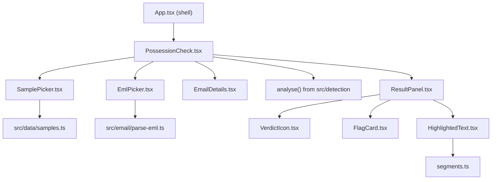
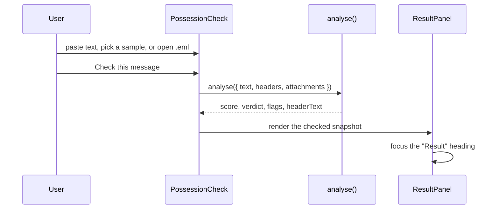

# Design Document: Possession Check UI

## Overview

The screen is one React feature folder, `src/features/possession-check/`, mounted in the app shell's `<main>`. It holds the message text, any loaded email details, and the last check. The check calls the pure `analyse()` synchronously. Two pure helpers sit beside the components: `segmentText` (splits text into highlight segments) and `parseEml` (reads `.eml` files). Both are property tested. Everything renders through React text nodes, so message content is never treated as HTML.

### Key decisions

| Decision | Choice | Reason |
| --- | --- | --- |
| Where the feature lives | `src/features/possession-check/` | The foundation rule says shell files (`App.tsx`, `src/components/`) do not import the engine. The shell now hosts a feature that does. |
| Result snapshot | The result stores the exact text and details that were checked | Highlights always index the text that was analysed. Editing the box clears the result so it never describes other text. |
| `.eml` body | Prefer HTML converted to text with links as `text <url>`, fall back to plain text | The engine detects `text <url>` mismatches, so link tricks in HTML emails survive conversion. Conversion uses regular expressions on strings, never the DOM. |
| Kept headers | From, Reply-To, Return-Path, Sender, To, Subject, Date, Authentication-Results, ARC-Authentication-Results, Received-SPF | These are the headers people and the engine use. Long `Received` chains would bury the highlights. |
| Sample menu | Native `<select>` | Works with keyboard, touch and screen readers without custom ARIA. |
| File button | A real `<button>` that opens a visually hidden file input | A button is the clearest keyboard target. The drop zone is an extra for mouse users. |
| Verdict icon | Octagon (likely scam), triangle (suspicious), circle with a tick (looks safe), inline SVG with `aria-hidden` | Shape carries meaning for colour-blind users. Text carries it for screen readers. |
| Score display | Text plus `<meter>` | `<meter>` is native and accessible, and needs no inline `style` (blocked by the CSP). |
| Highlight references | Number after each highlight with visually hidden "red flag" text | Screen readers do not announce `<mark>`, but they read the reference. |
| Focus | Move focus to the result heading after a check | Screen reader users hear the result without searching. |
| New tokens | `--color-verdict-scam`, `--color-verdict-suspicious`, `--color-verdict-safe`, `--color-highlight` in both views | Verdict colours are checked at 3:1 and highlighted text at 4.5:1 by the token test. |

## Architecture





## Components and Interfaces

- `PossessionCheck()`: state `text`, `details?: { origin: string; headers; attachments; subject; from; linkCount }`, `checked?: { input, result }`, `error?`, `notice?`.
- `SamplePicker({ value, onPick })`: labelled native select.
- `EmlPicker({ onLoaded, onError })`: drop zone, button, hidden `<input type="file" accept=".eml,message/rfc822">`. Reads files with `Blob.text()` or `FileReader`.
- `EmailDetails({ details, onRemove })`: summary list and "Remove email details" button.
- `ResultPanel({ input, result })`: heading with `tabIndex={-1}`, verdict, score, advice, disclaimer, highlighted message, header and attachment highlights, flag cards.
- `VerdictIcon({ verdict })`: inline SVG, `aria-hidden="true"`, `data-shape` attribute.
- `FlagCard({ flag, number, attachmentName })`: `<li>` card.
- `HighlightedText({ text, flags })`: `<mark>` segments and reference numbers.
- `segmentText(text, spans): Segment[]` where `Segment = { start, end, text, covering: number[], ending: number[] }`.
- `parseEml(raw): ParsedEmail` with `{ headers, headerText, subject, from, body, links, attachments }`. It throws `EmlParseError` when there is no header block.

## Data Models

```ts
interface Segment {
  start: number;
  end: number;
  text: string;
  covering: number[]; // indexes of spans covering this segment
  ending: number[];   // indexes of spans that end at this segment's end
}

interface ParsedEmail {
  headers: Record<string, string>;
  headerText: string;
  subject: string;
  from: string;
  body: string;
  links: string[];
  attachments: string[];
}
```

## Correctness Properties

*A property is a characteristic or behavior that should hold true across all valid executions of a system-essentially, a formal statement about what the system should do. Properties serve as the bridge between human-readable specifications and machine-verifiable correctness guarantees.*

### Property 1: Segments rebuild the text and mark exactly the covered characters

*For any* text and any list of spans inside it, joining the segment texts in order gives back the text, no segment is empty, and a character is in a segment covered by span `i` if and only if span `i` contains that character.

**Validates: Requirements 7.2, 7.1**

### Property 2: Every span ends exactly once

*For any* text and any list of non-empty spans inside it, each span index appears in the `ending` list of exactly one segment, and that segment ends where the span ends.

**Validates: Requirements 7.3**

### Property 3: Email bodies survive an .eml round trip

*For any* Unicode body text and subject, an `.eml` built with a base64 or quoted-printable UTF-8 body and an encoded-word subject parses back to the same body (with line endings normalised) and the same subject.

**Validates: Requirements 2.3**

### Property 4: Attachment names survive an .eml round trip

*For any* list of safe file names, a multipart `.eml` with one attachment part per name parses back to the same names in the same order.

**Validates: Requirements 2.3**

## Error Handling

- Wrong file type, a file over 5 MB, or no header block: the alert names the problem in plain words, and the message box is unchanged.
- Unknown charsets fall back to UTF-8. Broken base64 falls back to the raw text. The parser never throws for a malformed part, only for a missing header block.
- An empty check shows an alert linked to the message box and moves focus to the box.

## Testing Strategy

- `segments.test.ts`: Properties 1 and 2, plus overlap examples.
- `parse-eml.test.ts`: examples (folded and encoded headers, multipart alternative, attachments, HTML links, quoted-printable, no header block) and Properties 3 and 4.
- `PossessionCheck.test.tsx`:
  - Flows: typing and checking, empty-check alert, every sample's verdict, picking and dropping an `.eml`, the wrong-file alert, removing details, editing that clears the result.
  - Accessibility: focus moves to the result, a keyboard-only flow works, highlight marks and their references are present, verdict icon shapes are hidden from assistive technology, and axe passes before and after a check in both views.
- `tokens.test.ts` is extended with the new verdict and highlight tokens.