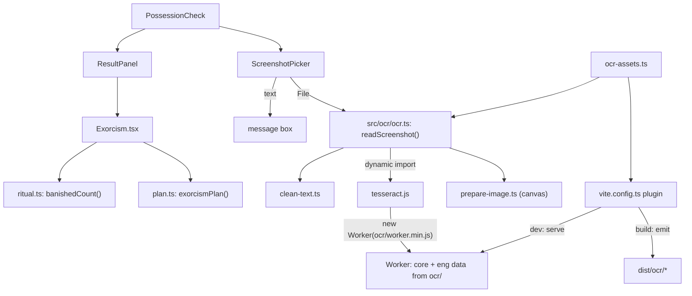
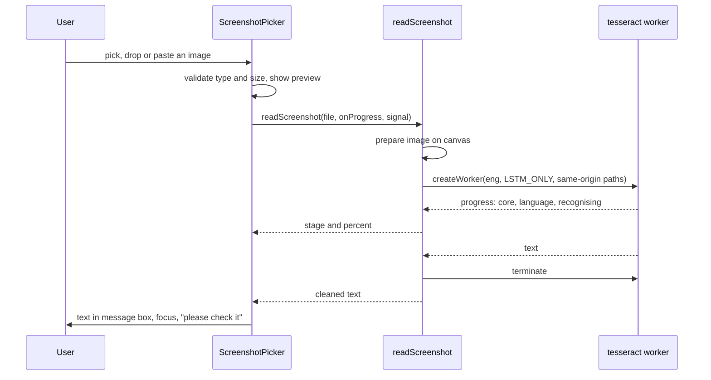

# Design Document: Screenshot and Exorcism

## Overview

Two independent pieces share the Possession Check screen.

1. **Screenshots** add a `ScreenshotPicker` next to the `.eml` picker. A picked, dropped or pasted image goes through `src/ocr/`. That module prepares the image on a canvas, loads tesseract.js on demand, recognises the text in a same-origin worker, and returns cleaned text. The text lands in the existing message box, so the user edits it there and presses the existing "Check this message" button.
2. **Exorcism** is a new feature in `src/features/exorcism/`. The pure function `exorcismPlan(result)` turns an analysis result into steps and family warnings. `Exorcism.tsx` renders them as a plain numbered list in Mortal view, and as a ritual with a fading ghost circle in Haunted view.

### Key decisions

| Decision | Choice | Reason |
| --- | --- | --- |
| OCR engine | tesseract.js 7 (Apache-2.0), English LSTM `best_int` data (2.9 MB) | Runs fully in the browser and is free. `best_int` is about a quarter the size of the full model with nearly the same accuracy. |
| Where OCR files come from | A Vite plugin copies them from `node_modules` into `dist/ocr/` and serves them in dev | Same origin, so `script-src 'self'` and "no other origin" hold. No 10 MB binaries are committed to git. |
| Worker start | `workerBlobURL: false` and `workerPath` set to `ocr/worker.min.js` | The default makes a `blob:` worker, which `script-src 'self'` blocks, and its `fetch` would break `connect-src 'none'`. |
| Core build | Ship the three LSTM-only builds (plain, SIMD, relaxed SIMD) and let tesseract pick | Each device downloads only the one it can run, about 3.9 MB. |
| No storage | `cacheMethod: 'none'` | tesseract caches language data in IndexedDB by default, which would break the storage rule. The browser's normal HTTP cache still makes repeat visits fast. |
| Image input | Always a `Blob` (prepared PNG, or the original file as a fallback) | A string source makes tesseract call `fetch`. A `Blob` is read with `FileReader`. |
| Preprocessing | Canvas: scale to at least 1200px wide (max 2.5x), greyscale, invert when the mean brightness is below 45% | WhatsApp dark mode and small phone screenshots read badly otherwise. If canvas fails, the original file is used. |
| Worker life | One worker per screenshot, ended afterwards | Frees tens of MB on low-end phones. Reading is rare, so start-up time does not matter much. |
| Preview | `FileReader.readAsDataURL` shown in `` | `img-src 'self' data:` already allows it. A `blob:` URL would need a CSP change. |
| Testability | `OcrReader` interface injected into `PossessionCheck` (defaults to the real one) | jsdom has no Worker or WebAssembly. Component tests use a fake reader. `scripts/ocr-check.mjs` tests the real engine in Edge or Chrome under the production CSP. |
| Exorcism placement | Inside the result, right after the verdict and score | Elders need the steps before the detailed flag list. |
| Plan logic | Pure `exorcismPlan(result)` built from fixed step and warning tables | Easy to property-test. It cannot leak message text into the family warning. |
| Haunted ritual | One checkbox per step, a ghost circle that fades in proportion | Checkboxes work with keyboard and screen readers. The steps' text is identical to Mortal view. |
| Ghost fading | `banishedCount(read, steps, ghosts) = floor(read * ghosts / steps)` | Monotonic. It reaches exactly all ghosts when all steps are read, whatever the counts. |
| Copy | `navigator.clipboard.writeText`, falling back to selecting the text | Works offline. The fallback still lets the user copy by hand. |
| Share | `navigator.share` only when present | The share sheet goes straight to WhatsApp on phones. It is the user's action, not an app network call. |

## Architecture





## Components and Interfaces

- `ocr-assets.ts` (root, next to `csp.ts`):
  - `OCR_DIR = 'ocr'`
  - `OCR_ASSETS: { path; source }[]`, which maps each served path to its file in `node_modules`.
  - `OCR_WORKER`, `OCR_CORE_DIR`, `OCR_LANG_DIR`.
- `src/ocr/types.ts`:
  - `OcrStage = 'starting' | 'loading-reader' | 'loading-language' | 'reading'`
  - `OcrProgress = { stage; percent }`
  - `OcrReader = (file: Blob, onProgress, signal: AbortSignal) => Promise<string>`
- `src/ocr/clean-text.ts`: `cleanOcrText(raw): string`.
- `src/ocr/progress.ts`: `toProgress(message)`, which maps tesseract logger messages to an `OcrProgress` with an overall 0 to 100 percent.
- `src/ocr/image-file.ts`: `checkImageFile(file): 'ok' | 'wrong-type' | 'too-big'` and `MAX_IMAGE_BYTES`.
- `src/ocr/prepare-image.ts`: `prepareImage(file): Promise<Blob>`.
- `src/ocr/ocr.ts`: `readScreenshot: OcrReader`. Errors are `OcrCancelled` and `OcrFailed`.
- `src/features/possession-check/ScreenshotPicker.tsx`: button, drop zone, hidden input, preview, Reading_State, "Stop reading". It exposes `readFile(file)` so the screen-level paste handler can use it.
- `src/features/exorcism/plan.ts`: `exorcismPlan(result): Plan | undefined`, `BASE_STEP_IDS`, `STEP_TRIGGERS`.
- `src/features/exorcism/ritual.ts`: `banishedCount(read, steps, ghosts)`.
- `src/features/exorcism/Exorcism.tsx` and `exorcism.css`.

## Data Models

```ts
interface Step {
  id: string;          // stable, e.g. 'do-not-reply', 'uninstall-remote-app'
  title: string;       // short imperative, e.g. "Do not reply"
  detail: string;      // one plain sentence
  urgent?: boolean;    // shown first
  links?: { label: string; href: string }[]; // only our own fixed links (cybercrime.gov.in, tel:1930)
}

interface FamilyWarning {
  en: string;
  hi: string;
}

interface Plan {
  intro: string;
  steps: Step[];
  warning: FamilyWarning;
}
```

Step order: urgent Flag_Steps, then the Base_Steps, then the other Flag_Steps, in a fixed table order.

The warning's "kind of scam" is chosen by priority: digital arrest, remote access, UPI refund, KYC, electricity, courier, job, payment request, sensitive info, attachment, lookalike or link, then a general fallback.

## Correctness Properties

*A property is a characteristic or behavior that should hold true across all valid executions of a system-essentially, a formal statement about what the system should do. Properties serve as the bridge between human-readable specifications and machine-verifiable correctness guarantees.*

### Property 1: Every scam or suspicious plan has the base steps, each once

*For any* analysis result with verdict "likely scam" or "suspicious", `exorcismPlan` returns steps that include all five Base_Steps, have unique ids, and list every urgent step before every non-urgent step.

**Validates: Requirements 5.3, 6.7**

### Property 2: Flag steps appear exactly when their flags do

*For any* set of red flag types, each Flag_Step is in the Plan if and only if at least one of its trigger types is in the set. A `remote-access-app` flag always puts the uninstall step first.

**Validates: Requirements 6.1, 6.2, 6.3, 6.4, 6.5, 6.6, 6.7**

### Property 3: Safe results get no plan

*For any* result with verdict "looks safe", `exorcismPlan` returns `undefined`.

**Validates: Requirements 5.2**

### Property 4: Family warnings never carry message text and always say how to report

*For any* message text containing a unique marker word, when its result has a Plan, neither warning contains the marker. Both warnings contain "cybercrime.gov.in" and "1930", the Hindi one contains Devanagari letters, and neither claims certainty.

**Validates: Requirements 7.2, 7.3, 5.6**

### Property 5: Ghosts are banished in order and all at the end

*For any* number of steps from 1 to 20 and ghosts from 0 to 30, `banishedCount` never decreases as more steps are read. It is 0 at read 0, equals the ghost count when every step is read, and never exceeds the ghost count.

**Validates: Requirements 8.3**

### Property 6: OCR text cleaning is idempotent and tidy

*For any* string, `cleanOcrText` gives the same result when applied twice. The result has no line with leading or trailing spaces, no two spaces in a row, no two empty lines in a row, and no empty line at the start or end.

**Validates: Requirements 4.3**

### Property 7: OCR progress only moves forward within a read

*For any* ordered sequence of tesseract logger messages through the known stages, with progress values from 0 to 1, the overall percent from `toProgress` stays from 0 to 100, and never decreases when stages arrive in order.

**Validates: Requirements 3.1**

## Error Handling

- Wrong type or file too big: an alert, and the message is kept.
- No words found: an alert suggesting a clearer screenshot or typing.
- OCR fails to start (for example no WebAssembly) or recognition throws: an alert saying it could not be read, the worker is ended and the state is reset.
- Stop reading: `AbortSignal` ends the worker. The promise rejects with `OcrCancelled`, which shows a status note rather than an error.
- Image preparation fails: the original file is used.
- Clipboard write fails: the warning text is selected and the status says "Press Ctrl+C or long-press to copy."

## Testing Strategy

- Pure:
  - `plan.test.ts`: Properties 1 to 4, plus examples for each trigger and both warnings.
  - `ritual.test.ts`: Property 5.
  - `clean-text.test.ts`: Property 6.
  - `progress.test.ts`: Property 7.
  - `image-file.test.ts`: type and size checks.
- Components with a fake `OcrReader`:
  - `ScreenshotPicker`: pick, drop and paste, progress stages, stop, errors, focus after reading, no auto-check.
  - `Exorcism`: shown only for scam or suspicious, links, flag steps, copy and share.
  - Haunted view: the ritual with checkboxes, banished ghosts, progress status, and axe in both views.
- Browser: `scripts/ocr-check.mjs` checks the real engine end to end under the production CSP. It records the text read, request origins, IndexedDB databases, localStorage keys and CSP violations.
- Repo conformance: the README lists the OCR licences, and the licence files exist.