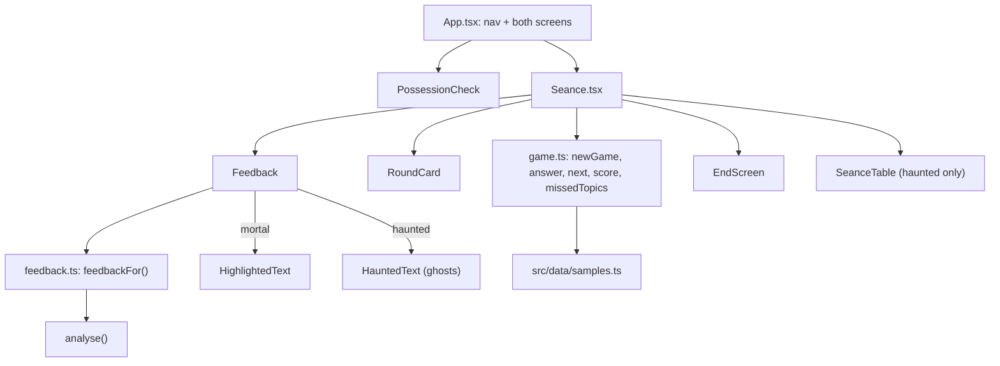
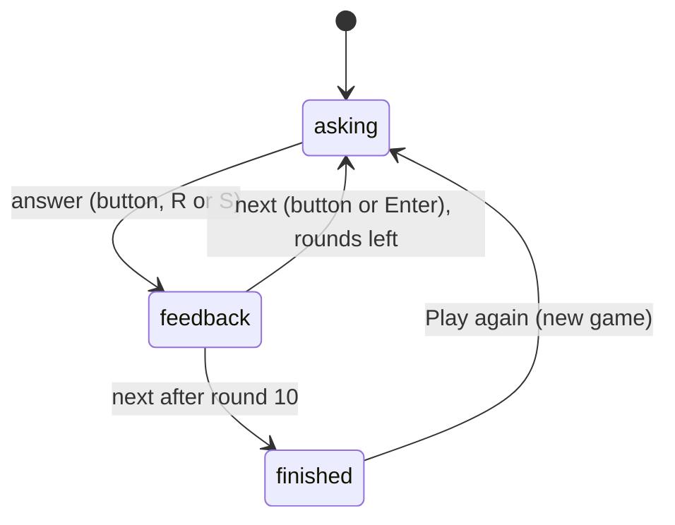

# Design Document: Séance

## Overview

Séance is a feature folder, `src/features/seance/`, mounted by the shell next to Possession Check. The game is a small pure state machine in `game.ts`, and the wording for each answer is built by a pure `feedback.ts` that calls the real engine. React components render the round, feedback and end screen. Mortal view shows plain cards. Haunted view adds a séance table with candles and reuses the ghost renderer from Possession Check, so missed ghosts sit on the exact words.

### Key decisions

| Decision | Choice | Reason |
| --- | --- | --- |
| Where the game lives | `src/features/seance/` | Shell files must not import the engine directly. Features may. |
| Screen switching | Two buttons in a labelled `<nav>`, `aria-current="page"`, both screens mounted, the inactive one `hidden` | Keeps a half-checked message or a game in progress. Nothing goes in the URL or storage. |
| Round mix | 10 rounds, 5 to 7 scams chosen at random, Fisher-Yates shuffle | "About 6 and 4", but a player cannot count their way to the last answers. |
| Randomness | `newGame(pool, random)` takes a `() => number` (default `Math.random`) | The engine stays pure. Tests use a seeded generator and know every round. |
| Truth | A sample is a scam when its expected verdict is not "looks safe" | The sample tests already pin the engine's verdict to this label. |
| Wording about truth | "This practice message is a scam / is real." | The samples are made up, so their labels are known. The engine's own verdict is still shown as "Phantom Inbox's check". |
| Main flags | Strongest first, one per type, at most 3, then shown in message order and numbered | One clear lesson per round. The numbers match the highlights. |
| Safe explanations | `safeReasons` written for each genuine sample | The engine can only say "no warning signs". People need the positive reasons a message is fine. |
| Missed types | `topic` on each sample, and a tip per scam topic | The end screen can say "Courier fee messages" instead of rule names. |
| Haunted ghosts | Reuse `HauntedText` for the missed scam's flags. A `seance-missed` class makes the ghosts drift up | The ghosts are already accessible buttons with reasons. |
| Candles | A row of 10 CSS candles on an oval table. Lit count equals right answers. Flame flicker is opacity and transform only | Same budget as the rest of Haunted view. |
| Shortcuts | One `keydown` listener on `document` while the screen is active | Skips text fields, modifier keys, repeats and native Enter on buttons and links. |
| Announcements | A `role="status"` line with the outcome and running score, plus focus on each new heading | Screen reader users hear the result, then can read on. |

## Architecture





## Components and Interfaces

- `game.ts`:
  - `type Guess = 'real' | 'scam'`, `type Phase = 'asking' | 'feedback' | 'finished'`.
  - `interface GameState { rounds: SampleMessage[]; answers: Guess[]; phase: Phase }`.
  - `newGame(pool, random?, size = 10)`, `answer(state, guess)`, `next(state)`.
  - `isScamSample(sample)`, `isCorrect(sample, guess)`, `scoreOf(state)`, `currentIndex(state)`.
  - `missedTopics(state)`, `falseAlarms(state)`.
- `feedback.ts`:
  - `outcomeOf(sample, guess)`.
  - `mainFlags(result)`.
  - `feedbackFor(sample, guess): Feedback`, returning `{ outcome, title, message, result, flags, safeReasons }`.
  - `endSummary(score)`, `TOPIC_TIPS`.
- `Seance.tsx`: `({ active, random })`. It owns the game state, the status line and the shortcuts.
- `RoundCard.tsx`, `FeedbackPanel.tsx`, `EndScreen.tsx`, `SeanceTable.tsx`, `seance.css`.

## Data Models

```ts
type Outcome = 'spotted-scam' | 'spotted-real' | 'missed-scam' | 'false-alarm';

interface Feedback {
  outcome: Outcome;
  title: string;               // "Well spotted!" or a kind heading
  message: string;             // one or two plain sentences
  result: AnalysisResult;      // the engine's own check
  flags: { flag: RedFlag; number: number }[]; // Main_Flags, numbered in message order
  safeReasons: readonly string[];
}
```

Samples gain `topic: SampleTopic` and, for genuine ones, `safeReasons: readonly string[]`.

## Correctness Properties

*A property is a characteristic or behavior that should hold true across all valid executions of a system-essentially, a formal statement about what the system should do. Properties serve as the bridge between human-readable specifications and machine-verifiable correctness guarantees.*

### Property 1: A game always has 10 unique rounds with a fair mix

*For any* sequence of random numbers in [0, 1), `newGame(SAMPLES, random)` returns exactly 10 rounds. All rounds have different ids and come from the pool, and between 5 and 7 of them are scams.

**Validates: Requirements 2.3**

### Property 2: The score is always 0 to 10 and counts right answers

*For any* game and any sequence of guesses, playing through with `answer` and `next` keeps the score between 0 and 10. It equals the number of guesses that match the samples, and the game ends finished after exactly 10 answers.

**Validates: Requirements 4.1, 5.1**

### Property 3: Every scam sample is checked as suspicious or likely scam

*For any* scam sample in the pool, `analyse(sample).verdict` is "suspicious" or "likely scam".

**Validates: Requirements 2.1, 4.1**

### Property 4: No genuine sample gets a high-severity flag

*For any* genuine sample in the pool, `analyse(sample)` returns no flag with severity "high", and its verdict is "looks safe".

**Validates: Requirements 2.1, 4.4**

### Property 5: Feedback is kind and points at real words

*For any* sample and guess, `feedbackFor`:
- returns the outcome that matches the truth and the guess;
- uses no shaming words;
- returns at most 3 main flags, one per type, with spans inside their source text;
- returns safe reasons exactly when the sample is genuine.

**Validates: Requirements 4.2, 4.3, 4.4, 4.5, 4.6**

### Property 6: Missed topics are exactly the scams answered "real"

*For any* finished game, `missedTopics` lists, once each, the topics of the scam rounds answered "real". It is empty exactly when every scam was spotted.

**Validates: Requirements 5.2**

## Error Handling

- `answer` does nothing unless the phase is "asking", and `next` does nothing unless the phase is "feedback". So double presses and key repeats cannot skip rounds.
- If the pool cannot supply 5 scams and the rest genuine, `newGame` throws during development. The sample test pins the pool size, so this cannot happen in the app.

## Testing Strategy

- `game.test.ts`: Properties 1, 2 and 6, plus phase guards.
- `feedback.test.ts`: Property 5, plus examples for each outcome, main flag choice and end-screen lines.
- `samples.test.ts`: Properties 3 and 4, pool size, topics, safe reasons and coverage.
- `Seance.test.tsx`, with a seeded generator:
  - A full game by clicks, missed scams and false alarms, and the end screen with missed topics and Play again.
  - A full game by keyboard (R, S, Enter), and that shortcuts are ignored in text fields and on other screens.
  - Status announcements and focus.
  - Candles in Haunted view, and axe in both views on a round, feedback and the end screen.
- `App.test.tsx`: the navigation keeps the other screen's state.
- `scripts/perf-mobile.mjs`: a Séance scenario in Haunted view.